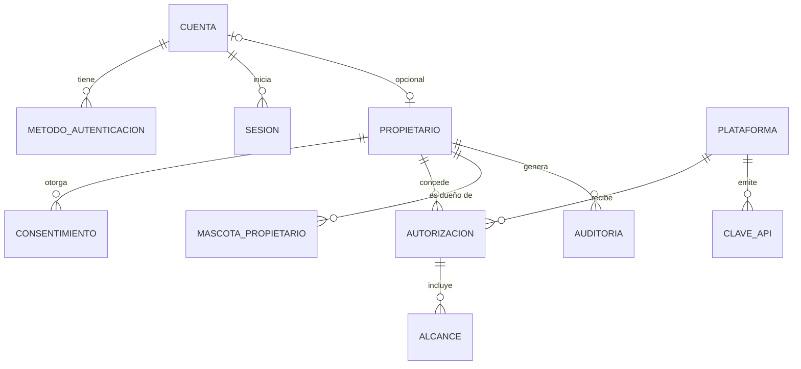
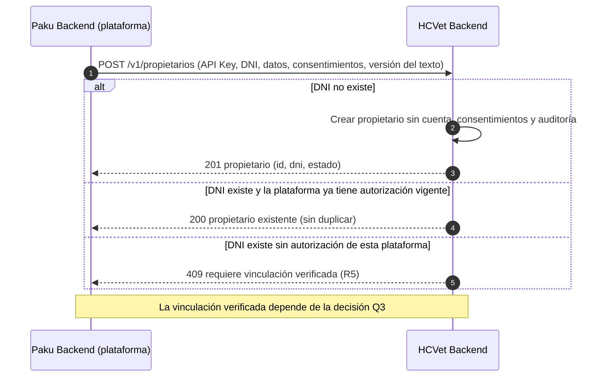

# PAKU + HCVET — Plan de implementación: bloque A (propietarios, identidad y autorización)

Estado: **borrador de diagnóstico y propuesta técnica**. No es una especificación aprobada.
Requerimientos de referencia: [PAKU-HCVET-REQUIREMENTS.md](PAKU-HCVET-REQUIREMENTS.md).
Tareas de este bloque: [PAKU-HCVET-TASKS.md](PAKU-HCVET-TASKS.md) (`HCV-001` a `HCV-013`).
Fecha del diagnóstico: 2026-11-27. Repositorio analizado: `hcvet-backend` (commit `e69a704`).

---

## 1. Alcance de este bloque

Incluido:

- Registro e identificación de propietarios.
- Separación entre propietario y cuenta de autenticación.
- Autenticación de plataformas mediante API Key.
- Autorización delegada sin contraseñas individuales.
- Consentimientos y permisos.
- Auditoría y trazabilidad de los cambios anteriores.

Fuera de alcance (se analizarán en bloques posteriores):

- Mascotas y Pet-records de Paku, frontends y migración de datos existentes.
- Integración con Datos Perú: la consulta de DNI la hace Paku, no HCVet.
- Idempotencia y anulación: son fases de HCVet ya planificadas (`0002`, `0003`). Este bloque las **depende** (ver §6).

---

## 2. Diagnóstico actual de HCVet

### 2.1. Modelo de datos

| Entidad | Dónde | Hecho verificado |
|---|---|---|
| Cuenta | `src/hcvet/modulos/cuentas/modelos.py` | Credenciales y estado (`registro_incompleto` / `activa`). Tipos: `propietario`, `administrador`. |
| Método de autenticación | `cuentas/modelos.py` (`MetodoAutenticacion`) | Tabla por tipo; hoy solo `contrasena` funciona. Google, Facebook, Apple y OTP existen en el enum, sin implementar. |
| Sesión | `cuentas/modelos.py` (`SesionUsuario`) | Token opaco; en BD solo su SHA-256. |
| Propietario | `propietarios/modelos.py` | `cuenta_id` **obligatorio y único** (1:1). DNI único. Datos personales, `permite_indexacion_veterinaria`, `permite_uso_comercial`, `identidad_validada_en`. |
| Centro (plataforma) | `centros/modelos.py` | Nombre comercial, razón social, RUC, representante, correo, teléfono. Sin cuenta. |
| Clave de API | `centros/modelos.py` (`ClaveApi`) | `hcv_` + 43 caracteres; en BD SHA-256 y prefijo de 12; revocable. |

**Lectura:** la separación entre cuenta y propietario **ya existe en tablas** (D-046). Lo que la acopla es la cardinalidad obligatoria `propietario → cuenta` y el hecho de que **activar un propietario exige email y contraseña** (`cuentas/servicio.py::activar`). Por eso un propietario no puede existir sin credenciales.

### 2.2. Registro y activación

- `POST /v1/cuentas` crea una cuenta en `registro_incompleto` con email y contraseña (`cuentas/servicio.py::iniciar_registro`).
- `POST /v1/cuentas/activacion` activa la cuenta con `PropietarioCrear`: DNI, nombres, apellidos, distrito, teléfono y **ambos consentimientos obligatorios** (`propietarios/esquemas.py`).
- Si el DNI ya existe, responde **409** (`cuentas/servicio.py::activar`, D-049). No hay vinculación.
- `POST /v1/propietarios` fue retirado (D-048): el propietario nace solo al activar una cuenta.
- `identidad/` tiene el contrato `ProveedorIdentidad` y `validar_identidad`, pero **nada lo llama**. `identidad_validada_en` nunca se escribe.

### 2.3. Acceso y actores

- Toda ruta de dominio exige `Authorization: Bearer` (`acceso/dependencias.py`).
- Prefijo `hcv_` → **ActorCentro** (clave de API, `centros/servicio.py::centro_por_clave`).
- Otro token → **ActorPropietario** (sesión de cuenta con propietario activo) o 403 (administrador o propietario sin registro).
- No existe ningún actor que represente a una plataforma **en nombre de** un dueño.

### 2.4. Visibilidad y escritura (reglas vigentes)

Funciones puras en `acceso/reglas.py`:

- `puede_ver_propietario`: un dueño ve su propio DNI; un centro ve a cualquier dueño con `permite_indexacion_veterinaria = true`.
- `puede_ver_mascota`: igual, por sus vínculos.
- `puede_modificar_mascota`: solo un dueño asociado.

Escritura (`mascotas/servicio.py::crear`): un dueño crea mascotas a su nombre; un centro crea mascotas para **cualquier** dueño indexado.

Esto implica que **una API Key vigente puede leer y escribir sobre todos los dueños indexados**, sin alcance ni consentimiento por plataforma (D-066, D-067).

### 2.5. Consentimientos

- `permite_indexacion_veterinaria`: booleano, sin fecha, sin versión, sin plataforma de origen. Se cambia con `PATCH /v1/propietarios/{dni}/permisos`, **solo por el propio dueño con sesión** (`propietarios/servicio.py::cambiar_indexacion`). Su efecto es inmediato (la visibilidad se calcula en cada petición).
- `permite_uso_comercial`: booleano almacenado. **Sin lógica, sin endpoint de cambio** (`DOMAIN.md`, "Sin definir").
- No hay historial de consentimientos ni de revocaciones.

### 2.6. Auditoría

- Solo `creado_en` en cada tabla (D-040), asignado por PostgreSQL. No hay `actualizado_en` en propietarios.
- No existe tabla de auditoría. La única trazabilidad es el registrante de eventos y pesos (D-068).
- La anulación con "quién y cuándo" (`0003`) aún no existe.

### 2.7. Idempotencia y concurrencia

- No hay `Idempotency-Key` (fase 2, `0002`).
- El DNI es `UNIQUE`, pero la activación hace una consulta previa y luego un `INSERT`. Dos peticiones concurrentes con el mismo DNI pueden fallar con una violación de restricción no traducida a 409 (ya registrado como pendiente en `STATUS.md`).

### 2.8. Límites y seguridad de claves

- Hash SHA-256 de la clave, prefijo visible, revocación inmediata. Bien.
- No hay vencimiento, último uso, límite de peticiones ni alcances por clave.
- No hay límite de peticiones (rate limiting) en ninguna ruta. Verificado con búsqueda en `src/`.

---

## 3. Contraste de requerimientos con la implementación

Leyenda: **Existe** = cumple hoy · **Parcial** = existe una base, falta parte · **No existe** = hay que construirlo.

| # | Requerimiento (REQUIREMENTS §) | Estado | Evidencia | Cambio necesario | Complejidad | Dependencias | Riesgos |
|---|---|---|---|---|---|---|---|
| R1 | Propietario como entidad independiente de cuenta (§3.3) | **Parcial** | Tablas separadas, pero `cuenta_id` obligatorio (D-048) | Hacer la cuenta opcional; `email` pasa a ser dato del propietario cuando no hay cuenta | Media | Decisión Q1 | Romper `ActorPropietario`, `PropietarioLeido.email`, activación |
| R2 | Registrar propietario sin contraseña (§3.3, §7) | **No existe** | `POST /v1/propietarios` retirado (D-048); solo alta con cuenta y contraseña | Alta por plataforma autorizada (`POST /v1/propietarios`) sin credenciales del dueño | Alta | R1, R5, Q1 | Alta sin titularidad comprobada (ver R5) |
| R3 | Registro idempotente y sin duplicados, incluso concurrente (§7) | **Parcial** | DNI `UNIQUE`; 409 en activación; sin `Idempotency-Key`; posible 500 por carrera | Traducir violación de DNI a 409/200 según la regla; idempotencia por clave (fase 2) | Media | `0002` (fase 2) | Duplicados por reintento sin la clave |
| R4 | Identificar propietario por DNI, de forma autorizada (§5.2) | **Parcial** | `GET /v1/propietarios/{dni}`: dueño (propio) o centro (indexado) | Consulta por alcance de la plataforma y autorización vigente, no solo por indexación | Media | R7, R8 | Enumeración de DNI (ya mitigada con 404 uniforme) |
| R5 | Vincular propietario existente tras verificar identidad (§4.5, §7.1) | **No existe** | DNI ya usado → 409 (D-049); `validar_identidad` sin usar; `identidad_validada_en` nunca escrito | Flujo de vinculación con prueba de titularidad (Q3) | Alta | Q3, R7 | Suplantación si la prueba es débil |
| R6 | Actualizar datos básicos del propietario de forma controlada (§7.2) | **No existe** | Solo `PATCH …/permisos`, y solo para el dueño con sesión | Endpoint de datos básicos con origen, fecha y política de conflicto | Media | R7, R10 | Sobrescribir datos recientes con datos viejos |
| R7 | Autenticación de plataformas por API Key (§5.1, §5.2) | **Existe** | `ClaveApi`, `centro_por_clave`, emisión y revocación por admin (D-064, D-065) | Reutilizar; añadir último uso y, si se necesita, vencimiento | Baja | — | Ninguno relevante |
| R8 | Identificación de la plataforma o establecimiento (§5.4) | **Parcial** | Tabla `centros` con datos legales; no distingue plataforma de establecimiento | Campo `tipo` (plataforma / establecimiento) y alias en documentación; sin renombrar la tabla | Baja | Q6 | Confusión de términos con DOMAIN |
| R9 | Autorización delegada sin contraseñas individuales (§3.3, §5.2) | **No existe** | `ActorCentro` no representa a un dueño; no hay tabla de autorizaciones | Entidad `autorizaciones` (plataforma + propietario + alcances) y actor "plataforma en representación" | Alta | R1, R7, Q2 | Ser el mecanismo central de seguridad del bloque |
| R10 | Permisos diferenciados por plataforma (§5.3) | **No existe** | Todo centro tiene los mismos permisos (D-067) | Catálogo de alcances; cada autorización lista los suyos; cada ruta exige su alcance | Alta | R9 | Complejidad excesiva si el catálogo crece sin control |
| R11 | Comprobación de permisos por recurso (§5.2) | **Parcial** | `puede_ver_*` y `puede_modificar_mascota` por recurso | Añadir la comprobación de autorización vigente a las reglas existentes | Media | R9, R10 | Regresiones en las reglas de visibilidad de fase 1 |
| R12 | Consentimientos separados por finalidad (§6) | **Parcial** | Dos booleanos; uso comercial sin lógica | Tabla `consentimientos` por tipo, con fecha, origen, finalidad y versión del texto | Media | Q4 | Migrar booleanos sin inventar fechas |
| R13 | Consentimiento no marcado por defecto (§6) | **Existe** | Obligatorio sin valor por defecto (D-028, D-069) | Mantener; la plataforma debe enviar la decisión explícita | Baja | — | Que una plataforma lo marque por defecto (control contractual) |
| R14 | Revocación con efecto inmediato y sin borrar historial (§6) | **Parcial** | Indexación revocable con efecto inmediato; uso comercial no revocable | Revocar autorizaciones y consentimientos sin borrar registros | Media | R9, R12 | Confundir revocar acceso con borrar datos |
| R15 | Auditoría de consultas y modificaciones (§5.4, §11) | **No existe** | Solo `creado_en` | Tabla de auditoría de sólo inserción para cambios del bloque | Media | — | Registrar PII en logs |
| R16 | Seguridad de API Keys: rotación, revocación, último uso (§5.4) | **Parcial** | Hash, prefijo, revocación; sin último uso ni vencimiento | `ultimo_uso_en`, vencimiento opcional, emisión de nueva clave sin cortar la anterior (ya existe) | Baja | — | Claves antiguas sin uso visible |
| R17 | Límite de peticiones por plataforma (§5.4, §15) | **No existe** | No hay rate limiting | Límite por clave en las rutas del bloque | Media | R7 | Falsos positivos entre plataformas que comparten IP |
| R18 | Protección de datos personales en logs (§5.4) | **Parcial** | `src/` no usa `logging` (verificado con búsqueda): no hay fuga de PII, pero tampoco trazas de operación | Definir qué se registra al introducir auditoría (R15) y enmascarar DNI y email | Baja | R15 | Registrar PII al añadir logs sin política |
| R19 | Sin dependencia funcional de Paku en HCVet (§1, §14) | **Existe** | Ninguna referencia a Paku en `src/` (verificado con búsqueda) | Mantener: el alcance debe ser genérico (plataforma), no "Paku" | Baja | — | Acoplarse por nombre en el código |

### 3.1. Lo que ya cumple y conviene conservar

- Separación de tablas propietario / cuenta (R1, parcial).
- API Key con hash, prefijo y revocación (R7).
- Consentimiento sin valor por defecto (R13).
- Visibilidad por recurso con 404 uniforme (`acceso/reglas.py`, constitución 18).
- Indexación revocable con efecto inmediato (R14, parcial).
- El dueño solo cambia su propio consentimiento con sesión.

### 3.2. Contradicciones entre los requerimientos y el repositorio

| Contradicción | Dónde | Propuesta de resolución |
|---|---|---|
| "Todo propietario pertenece a una cuenta (1:1)" (DOMAIN) frente a "el propietario existe sin contraseña" (REQUIREMENTS §3.3) | `DOMAIN.md` → Propietarios; D-048 | Cuenta opcional, con nueva decisión que sustituya D-048 (Q1). No se borra D-048: se marca como reemplazada (constitución 28). |
| "No duplicar propietarios por DNI" (REQUIREMENTS §7.1) frente a "DNI ya registrado → 409, sin vinculación" | D-049; `cuentas/servicio.py::activar` | Vinculación con verificación (R5); el 409 queda para el caso sin verificación. Requiere Q3. |
| "La posesión de una API Key no otorga acceso ilimitado" (REQUIREMENTS §5.2) frente a "un centro ve y escribe en todo dueño indexado" | D-066, D-067 | Autorización por plataforma y propietario; la indexación pasa a ser solo descubrimiento (Q2). |
| "Consentimiento por finalidad, con fecha y origen" (REQUIREMENTS §6) frente a dos booleanos | `propietarios/modelos.py` | Tabla de consentimientos; los booleanos quedan como proyección de compatibilidad durante una fase. |

---

## 4. Propuesta técnica

### 4.1. Modelo de identidad: propietario, cuenta y autorización separados



Principios:

- El **propietario** es la persona con su DNI. Existe aunque no tenga cuenta.
- La **cuenta** es solo una forma opcional de iniciar sesión en HCVet (uso directo por el dueño, que hoy existe).
- La **plataforma** (centro, en el modelo actual) se identifica con su API Key y actúa en nombre del propietario solo con una **autorización** vigente.
- Ningún actor nuevo requiere contraseña del propietario.

### 4.2. Autenticación de plataformas

Se reutiliza `ClaveApi` y `centro_por_clave` (R7). Cambios:

- `centros.tipo`: `plataforma` o `establecimiento`, sobre la tabla `centros` que se mantiene (Q6).
- `claves_api.ultimo_uso_en`: se actualiza al autenticar, con escritura limitada (no en cada petición si ya se actualizó hace poco).
- `claves_api.expira_en` (opcional, nulo por defecto): permite vencimiento sin afectar a las claves actuales.
- El prefijo `hcv_` se mantiene (D-073).

### 4.3. Autorización delegada

Nueva entidad `autorizaciones`:

| Campo | Descripción |
|---|---|
| `id` | Identificador interno |
| `plataforma_id` | Plataforma que recibe la autorización |
| `propietario_id` | Propietario que la concede |
| `estado` | `vigente` o `revocada` |
| `otorgada_en`, `revocada_en` | Fechas |
| `version_terminos` | Versión del texto que aceptó el dueño |
| `origen` | Canal por el que se concedió (plataforma, dueño con sesión) |
| Alcances | Relación con el catálogo de alcances (§4.4) |

Reglas:

1. Una autorización es única por par (plataforma, propietario) mientras esté vigente.
2. Para cualquier operación sobre un propietario, el actor plataforma debe tener una autorización vigente que incluya el alcance de esa operación. Si no, responde **404** para lecturas (no revelar existencia) y **403** para escrituras sobre un recurso visible.
3. Revocar una autorización impide operaciones futuras; no borra registros ya creados (ver Q8).
4. El dueño puede revocar desde su sesión, si tiene cuenta, o la plataforma puede registrar la revocación que el dueño le comunique, con evidencia (Q4).
5. Los alcances se asignan según las necesidades de cada plataforma. Una autorización **no se concede con todos los alcances por defecto**; cada alcance se elige y se registra de forma explícita (Q5).

Actor nuevo: `ActorPlataformaDelegada(plataforma, propietario, alcances)`, resuelto por `obtener_actor` cuando la petición trae API Key **y** el DNI del propietario en la ruta. Las rutas que no tienen DNI siguen sirviendo a `ActorCentro` como hoy, hasta que se migren.

### 4.4. Catálogo de alcances (aprobado, Q5)

| Alcance | Permite |
|---|---|
| `propietario.consultar` | Ver datos básicos del propietario |
| `propietario.registrar` | Dar de alta al propietario en HCVet |
| `propietario.actualizar` | Cambiar datos básicos: nombres, apellidos, distrito, teléfono y correo electrónico. Sujeto a las reglas de datos verificados (§4.8) |
| `mascota.consultar` | Ver la ficha de sus mascotas |
| `mascota.registrar` | Crear mascotas para el propietario |
| `mascota.actualizar` | Modificar la ficha |
| `historial.consultar` | Leer eventos y pesos |
| `evento.registrar` | Registrar eventos y pesos |
| `evento.corregir` | Corregir o anular **solo eventos propios** (registrados por la misma plataforma). Otros eventos, solo con autorización excepcional (ver spec 0005, pregunta abierta). Depende de la fase 3 |

Precisiones de la aprobación (Q5): (1) `propietario.actualizar` incluye el correo y respeta las reglas de datos verificados; (2) `evento.corregir` se limita a eventos propios, salvo autorización excepcional; (3) los alcances se asignan según las necesidades de cada plataforma y no se conceden en su totalidad de forma automática. La separación clínica y de grooming queda fuera de esta versión del catálogo.

### 4.5. Consentimientos

Nueva tabla `consentimientos`, una fila por cambio (historial):

| Campo | Descripción |
|---|---|
| `propietario_id` | Propietario |
| `tipo` | `indexacion_veterinaria`, `uso_comercial`, `historial_compartido`, `registro_eventos` (propuesta) |
| `concedido` | Booleano del último estado |
| `finalidad` | Texto o código de la finalidad |
| `version_texto` | Versión del texto legal aceptado |
| `origen` | Plataforma o `propietario` |
| `registrado_en` | Fecha |

Migración: cada booleano actual se convierte en una fila con `origen = migracion` y `registrado_en` igual a la fecha de activación; **no se inventan fechas ni versiones**, y la versión queda como `desconocida` (R12).

Los booleanos `permite_indexacion_veterinaria` y `permite_uso_comercial` se mantienen como proyección durante una fase, para no romper la API actual. Se retiran en una fase posterior con su propia decisión.

`permite_uso_comercial` queda **registrable, sin efecto** hasta que se defina su lógica (`DOMAIN.md`, Sin definir).

### 4.6. Registro de propietarios y vinculación



La clave de idempotencia (fase 2) y el `UNIQUE` de DNI cubren los reintentos y las peticiones concurrentes.

### 4.7. Consulta autorizada por DNI

Flujo: API Key → DNI → buscar propietario → comprobar **autorización vigente con alcance `propietario.consultar`** (la indexación solo decide la búsqueda por DNI, Q2) → responder o 404 uniforme. Se mantiene la respuesta de "no encontrado" para no revelar existencia (constitución 18).

### 4.8. Actualización controlada de datos básicos

- `PATCH /v1/propietarios/{dni}` con alcance `propietario.actualizar`, o con sesión del propio dueño.
- Cada campo registra `origen` y `actualizado_en` (nuevas columnas en `propietarios`).
- Campos: nombres, apellidos, distrito, teléfono y correo (Q5).
- Política (propuesta, pendiente de la spec 0005): un dato **verificado** no se sobrescribe con uno no verificado de otra plataforma; un cambio de DNI no está permitido; el conflicto responde **409** con los dos valores de origen sin revelar datos ajenos.
- **Correo con cuenta:** si el propietario tiene cuenta, el correo es la credencial de acceso (`cuentas.email`). Una plataforma no lo cambia sin que el dueño lo confirme. Esto respeta REQUIREMENTS §4.4 (no sustituir el correo autenticado). Sin cuenta, el correo es un dato del propietario.
- **Datos verificados:** en HCVet, los nombres y apellidos verificados son los que tienen `identidad_validada_en` o una verificación certificada por la plataforma (Q3). El correo no tiene verificación propia todavía.

### 4.9. Auditoría

Tabla `auditoria`, solo inserción: `ocurrido_en`, `actor` (identificador interno: `plataforma:{id}` o `propietario:{id}`, nunca el DNI), `accion`, `entidad`, `entidad_id`, `resumen` (sin valores personales). Se registran: alta y actualización de propietarios, cambios de consentimiento, emisión y revocación de claves, otorgamiento y revocación de autorizaciones.

Esto coincide con `ActorPropietario.identificador` y `ActorCentro.identificador` ya existentes (`acceso/actores.py`), que fueron pensados para auditoría.

### 4.10. Seguridad

- Rate limiting por clave de API en las rutas del bloque (R17).
- Política de logs para no registrar DNI ni email completos, definida con la auditoría (R18). Hoy `src/` no escribe logs.
- Las pruebas de acceso horizontal se listan en `HCV-012`.

---

## 5. Contratos de integración

Ningún endpoint nuevo existe todavía. Los existentes se indican como tales.

| Método y ruta | Estado | Actor | Solicitud | Respuesta | Errores | Idempotencia | Compatibilidad |
|---|---|---|---|---|---|---|---|
| `GET /v1/propietarios/{dni}` | **Existe** | Dueño (propio) o centro (indexado) | — | `PropietarioLeido` | 401, 404 | No aplica | Sin cambios en esta fase; luego se aplica R4 |
| `PATCH /v1/propietarios/{dni}/permisos` | **Existe** | Dueño con sesión | `{permite_indexacion_veterinaria}` | `PropietarioLeido` | 401, 403, 404 | No aplica | Se mantiene como proyección |
| `POST /v1/propietarios` | **Nuevo** (reemplaza D-048) | Plataforma con alcance `propietario.registrar` | `{dni, nombres, apellidos, distrito, telefono, email?, consentimientos[], version_texto}` | 201 nuevo o 200 existente | 401, 403, 409, 422 | Clave de idempotencia (fase 2) y `UNIQUE(dni)` | Nuevo; no rompe `/cuentas` |
| `PATCH /v1/propietarios/{dni}` | **Nuevo** | Plataforma con `propietario.actualizar` o dueño | Campos básicos, incluido correo (§4.8) | `PropietarioLeido` | 401, 403, 404, 409, 422 | No aplica | Nuevo |
| `GET /v1/propietarios/{dni}/consentimientos` | **Nuevo** | Dueño o plataforma autorizada | — | Lista por tipo con estado y fechas | 401, 403, 404 | No aplica | Nuevo |
| `PUT /v1/propietarios/{dni}/consentimientos/{tipo}` | **Nuevo** | Dueño (sesión) o plataforma con evidencia | `{concedido, finalidad, version_texto}` | Estado actual | 401, 403, 404, 422 | Por tipo y versión | Nuevo |
| `POST /v1/propietarios/{dni}/autorizaciones` | **Nuevo** | Plataforma o dueño (sesión) | `{alcances[], version_texto}` | 201 autorización | 401, 403, 404, 409, 422 | Por par plataforma-propietario | Nuevo |
| `DELETE /v1/propietarios/{dni}/autorizaciones/{id}` | **Nuevo** | Dueño (sesión) o plataforma que la concedió | — | 204 | 401, 403, 404 | Idempotente por naturaleza | Nuevo |
| `POST /v1/cuentas`, `POST /v1/cuentas/activacion` | **Existe** | Persona | Credenciales y datos | `CuentaLeida` | 409, 401 | No aplica | Se mantienen hasta decidir Q1 |
| `GET /v1/centros/actual` | **Existe** (feature 0004) | Plataforma (API Key) | — | Nombre, razón social, RUC | 401, 403 | No aplica | Sin cambios |

---

## 6. Dependencias con las fases de HCVet

| Este bloque necesita | Fase/feature | Estado |
|---|---|---|
| Registro idempotente sin duplicados | Fase 2, `0002` (`Idempotency-Key`) | Draft |
| Corrección o anulación de consentimientos o de eventos | Fase 3, `0003` | Draft |
| Paginación de historial (solo para lectura consolidada) | Fase 2, `0002` | Draft |

Lo que puede avanzar **sin** esas fases: R1, R7, R8, R9, R10, R11, R12, R13, R16, R18, R19. Lo que no puede cerrarse sin ellas: R2 y R3 (reintentos) y la anulación de consentimientos.

Propuesta de orden: avanzar con este bloque en paralelo a la fase 2, y dejar la idempotencia para `POST /v1/propietarios` como condición de cierre, no de inicio.

---

## 7. Decisiones pendientes

Solo se incluyen decisiones que cambian arquitectura, seguridad o reglas de negocio. Las decisiones ya fijadas en REQUIREMENTS (no usar contraseñas por usuario, consentimiento sin valor por defecto, API Key como identidad de plataforma, sin base de datos compartida) no se vuelven a preguntar.

**Q1. ¿La cuenta de acceso será opcional para el propietario?**
**Estado: Aprobada.** Cuenta opcional para propietarios. Sustituye a D-048 al registrarse en `DECISIONS.md` (HCV-001).

- *Por qué:* hoy todo propietario tiene cuenta con contraseña (D-048). Sin esto, R1 y R2 no se pueden cumplir.
- *Alternativas:* (a) cuenta opcional, el propietario puede existir sin ella; (b) mantener la cuenta obligatoria y crear una cuenta técnica por propietario (descartado por REQUIREMENTS §3.3).
- *Recomendación:* (a). Reemplaza D-048 y la regla de `DOMAIN.md`.
- *Tareas:* `HCV-003`, `HCV-008`.

**Q2. ¿La indexación veterinaria sigue siendo también la autorización de acceso?**
**Estado: Aprobada.** La indexación veterinaria es independiente de la autorización de acceso. La indexación solo decide si un dueño puede encontrarse por DNI; el acceso requiere autorización vigente de la plataforma.

- *Por qué:* hoy un centro con API Key accede a todo dueño indexado (D-066, D-067). REQUIREMENTS §5.2 exige que la API Key no dé acceso ilimitado.
- *Alternativas:* (a) la indexación solo permite **encontrar** al dueño por DNI; el acceso requiere autorización por plataforma; (b) la indexación sigue siendo acceso (estado actual, pero incumple §5.2).
- *Recomendación:* (a). Es un cambio de comportamiento para las plataformas que ya usan la API. Como la fase 1 está cerrada, se requiere un periodo de transición.
- *Tareas:* `HCV-006`, `HCV-009`.

**Q3. ¿Cómo se verifica la titularidad del DNI para vincular a un propietario que ya existe?**
**Estado: Aprobada con condición.** La plataforma certifica la titularidad del DNI mediante una verificación real. Consultar el DNI en un servicio no constituye prueba de titularidad. La condición obliga a que la spec 0005 defina qué evidencia debe presentar la plataforma y qué registra HCVet.

- *Por qué:* hoy un DNI existente se rechaza (D-049). REQUIREMENTS §4.5 y §7.1 piden vincular sin duplicar y sin suplantación.
- *Alternativas:*
  - (a) La plataforma de origen certifica la titularidad con su propia verificación (p. ej., contacto verificado), y HCVet registra el nivel de confianza y la plataforma que la certificó. Requiere confiar en plataformas autorizadas y auditarlas.
  - (b) Código de un solo uso enviado al contacto del propietario. HCVet no envía correos ni SMS hoy.
  - (c) Validación con un proveedor de identidad (RENIEC). No hay proveedor conectado (`identidad`, D-037).
- *Recomendación:* (a) para empezar, con auditoría y con el nivel de confianza guardado; (b) o (c) cuando exista infraestructura. Ninguna de las tres debe usarse sin documentar sus implicaciones (REQUIREMENTS §4.5).
- *Tareas:* `HCV-005`, `HCV-008`.

**Q4. ¿Quién registra el consentimiento y con qué evidencia?**
**Estado: Aprobada.**

- *Por qué:* REQUIREMENTS §6 pide fecha, plataforma de origen, finalidad y versión. Si la plataforma registra el consentimiento, HCVet depende de su palabra.
- *Alternativas:* (a) la plataforma registra el consentimiento con la versión del texto y se responde por el contrato; (b) el consentimiento solo se registra con sesión del propio dueño en HCVet.
- *Recomendación:* (a), con la versión del texto y el canal en cada registro, y con auditoría. Los textos legales deben aprobarse antes de producción (REQUIREMENTS §6).
- *Tareas:* `HCV-007`.

**Q5. ¿Qué alcances forman el catálogo inicial?**
**Estado: Aprobada** con precisiones (2026-11-27): `propietario.actualizar` incluye correo y respeta datos verificados; `evento.corregir` se limita a eventos propios salvo autorización excepcional; los alcances se asignan según las necesidades de cada plataforma y no se conceden en su totalidad de forma automática. Ver §4.4.

- *Por qué:* REQUIREMENTS §5.3 pide permisos diferenciados. El catálogo de §4.4 es una propuesta.
- *Alternativas:* (a) el catálogo de §4.4 con un solo alcance clínico; (b) separar alcances clínicos y de grooming desde el principio.
- *Recomendación:* (a) ahora; separar después con una decisión propia.
- *Tareas:* `HCV-005`, `HCV-006`.

**Q6. ¿Se renombra la tabla `centros` o se agrega un tipo?**
**Estado: Aprobada.** Se mantiene la tabla `centros` y se agrega el tipo.

- *Por qué:* el término "centro" de DOMAIN no alcanza para una plataforma que no atiende mascotas (REQUIREMENTS §1).
- *Alternativas:* (a) agregar `tipo` y mantener el nombre de tabla; (b) renombrar a `plataformas` con migración.
- *Recomendación:* (a). Evita una migración de nombre sin ganancia funcional.
- *Tareas:* `HCV-004`.

**Q7. ¿Qué ocurre si el DNI ya existe y la plataforma pide registrarlo sin verificación?**
**Estado: Aprobada**, sin revelar datos personales y evitando consultas abusivas. Consecuencias: el 409 de HCV-008 no devuelve nombres ni email; el límite por clave (HCV-011) evita sondeos masivos de DNI.

- *Por qué:* es el caso de R3 y R5 combinados.
- *Alternativas:* (a) 409 y se indica el flujo de vinculación; (b) 200 con los datos existentes, sin revelar nada más.
- *Recomendación:* (a), porque (b) permitiría enumerar DNIs registrados.
- *Tareas:* `HCV-008`.

**Q8. ¿Qué pasa con los registros creados por una plataforma cuando se revoca su autorización?**
**Estado: Aprobada.** Revocar una autorización no borra los registros ya creados.

- *Por qué:* REQUIREMENTS §6 dice que revocar no implica borrar el historial.
- *Alternativas:* (a) los registros siguen visibles para el dueño y el historial que ya tuvo la plataforma, pero la plataforma no escribe más; (b) los registros de esa plataforma dejan de ser visibles para el dueño.
- *Recomendación:* (a). Es coherente con que los eventos no se borran (D-076).
- *Tareas:* `HCV-005`, `HCV-012`.

---

## 8. Impacto en documentación SDD (sin modificar aún)

| Documento | Cambio previsto | Aprobación |
|---|---|---|
| `hcvet-backend/DOMAIN.md` (Propietarios, Credenciales, Permisos) | Cuenta opcional; autorización por plataforma; alcances; consentimientos | Tras decisiones Q1–Q8 |
| `hcvet-backend/DECISIONS.md` | Nuevas decisiones; D-048, D-049, D-066 y D-067 marcadas como reemplazadas en la parte correspondiente | Tras Q1–Q8 |
| `hcvet-backend/specs/constitution.md` | Regla 17 (consentimiento de indexación) y regla 18 podrían necesitar matices; ver si se cambia el concepto de "centro" (regla 16) | Requiere decisión explícita (constitución, cambios) |
| `hcvet-backend/ARCHITECTURE.md` | Módulos `autorizaciones`, `auditoria`, `consentimientos` y actor de plataforma | Tras spec aprobado |
| `hcvet-backend/specs/features/0005-…` (nueva) | Spec de identidad y autorización delegada | Requiere aprobación del usuario |
| `hcvet-backend/docs/INTEGRACION.md` | Nuevo flujo para plataformas | Tras implementación |
| `paku-backend/specs/integracion-hcvet/` | Requerimientos y este plan | Requerimientos son de referencia; este plan es un borrador |

Este documento es diagnóstico y propuesta. No cambia reglas de negocio ni crea specs aprobados.

---

## 9. Riesgos principales

1. **Vinculación sin titularidad (R5):** un DNI ajeno podría vincularse a una cuenta de plataforma. Mitigación: Q3, auditoría y nivel de confianza.
2. **Regresión en la fase 1 cerrada:** el cambio de Q2 puede dejar sin acceso a plataformas que ya lo usan. Mitigación: transición con alcances iguales a los actuales antes de restringir.
3. **Enumeración de DNI:** cualquier nueva ruta de consulta debe responder 404 uniforme (constitución 18).
4. **Crecimiento del catálogo de alcances:** mantener pocos alcances hasta necesitar más (REQUIREMENTS §5.3).
5. **Carreras en el alta:** sin fase 2, la vinculación concurrente puede generar errores 500.

---

# Bloque B — registro de usuarios de Paku con DNI e integración con Datos Perú

Requerimientos: REQUIREMENTS §4 y §13. Spec: `paku-backend/specs/features/0027-registro-con-dni/`. Tareas:
`PAKU-USERS-001` a `PAKU-USERS-009`. Fuera de alcance: registrar propietarios en HCVet, Pet y Pet-records.

## B.1. Diagnóstico (2026-11-28)

| Tema | Estado en el código |
|---|---|
| DNI en Paku | `users.dni` texto libre de 30, opcional en registro (`RegisterIn`), completado social (`CompleteProfileIn`), «Mi perfil» y alta por admin. Sin formato ni unicidad. |
| Perfil completo | `has_required_profile`: teléfono, sexo y fecha de nacimiento. Guard `require_profile_complete` en reservas y órdenes. |
| Login social | `User.new_social` crea el perfil incompleto; `PUT /users/me/complete` lo completa. |
| Frontends | `paku-web` (registro y perfil) y `paku-vet-dev` (registro y completar perfil) ya muestran DNI **opcional**. |
| Datos Perú | Solo `POST /v1/consultas`, protegida con **token de administrador** y con el proveedor elegido por quien llama. No hay consulta de DNI para clientes con API Key; su fase 3 tiene preguntas abiertas (campos, proveedor, fallos, Ley 29733). |

## B.2. Propuesta técnica

- DNI de 8 dígitos, normalizado; único entre cuentas en la aplicación (409 sin revelar la cuenta). Índice único en la
  base cuando se saneen los duplicados (bloque de migración).
- Obligatoriedad para clientes detrás de `DNI_OBLIGATORIO` (apagada por defecto) para no romper las apps actuales; al
  activarla se exige en registro, completado social y para reservar (`missing_fields` incluye `dni`).
- Regularización: el login no cambia; `GET /users/me` expone `missing_profile_fields`.
- Consulta de DNI en Paku Backend (`POST /users/me/dni/consulta`) con puerto `ConsultorDni`, límites por usuario y caché.
  Adaptador de Datos Perú **bloqueado** hasta que exista su contrato para clientes; mientras tanto responde 503.
- No se usa el token de administrador de Datos Perú desde Paku (sería entregar a Paku el control total de Datos Perú).

## B.3. Bloqueos y decisiones pendientes

1. ~~Datos Perú sin consulta de DNI para clientes~~: resuelto el 2026-11-28 (Datos Perú spec 0008, PAKU-USERS-007).
   Antes de producción: aprobación legal definitiva en Datos Perú.
2. ~~Frontends~~: implementados el 2026-11-28 (PAKU-USERS-008), sin verificar en navegador ni dispositivo.
   `DNI_OBLIGATORIO` sigue apagado hasta publicarlos.
3. ~~Nombre legal frente a nombre de visualización~~: separados (aprobado el 2026-11-28; columnas `legal_*`).
4. Índice único de `users.dni`: migración `e8f3a1c7d5b2` y diagnóstico listos (PAKU-USERS-009); falta correr el
   diagnóstico contra la base real, sanear y aplicar antes de producción.
5. **Bloque B completado en implementación** (aprobado el 2026-11-28). Pendientes previos a producción: B-P1 a B-P5 en
   `PAKU-HCVET-TASKS.md`.

---

# Bloque C — integración y vinculación de propietarios

Requerimientos: §5, §6, §7 y §11. Spec: `paku-backend/specs/features/0028-integracion-propietarios-hcvet/`. Tareas:
`PAKU-OWNERS-001` a `010`. Fuera de alcance: Pet, Pet-records y migración masiva.

## C.1. Diagnóstico (2026-11-28)

| Tema | Estado |
|---|---|
| HCVet | Contratos listos (feature 0005): alta con `Idempotency-Key`, vinculación, consentimientos por finalidad, PATCH con `datos_al` y 429 por plataforma. Sin desplegar (HCV-014). |
| Paku | Sin cliente de HCVet, consentimientos ni referencia externa. Tiene scheduler (APScheduler) y un patrón de reintentos (feature 0018). |
| Titularidad | ~~HCVet exige evidencia (D-086)~~. **Rectificado el 2026-11-28 (D-105):** sin evidencia; la vinculación a un propietario existente es de acceso básico. |

## C.2. Arquitectura

```text
Front (web/app) → PUT /users/me/hcvet/consentimientos → Paku Backend
   guarda la evidencia y encola la operación (misma transacción) → responde sin llamar a HCVet
Scheduler (1 min) → ProcesadorHcvet → precondiciones (consentimiento, datos, titularidad)
   → ClienteHcvet (API Key) → HCVet → guarda el id externo, el estado o el próximo reintento
```

- Outbox transaccional (`hcvet_operaciones`) en lugar de llamadas síncronas: Paku responde igual con HCVet caído y
  ninguna venta depende de HCVet.
- Alcances explícitos (`ALCANCES_PAKU`) y consentimientos separados, mapeados uno a uno a los de HCVet; el de
  integración equivale a la autorización delegada.
- Sin verificación de titularidad (D-105). Alta automática de DNI nuevos; con un DNI existente, vinculación de acceso
  básico (sin acceso a lo preexistente) que solo el dueño amplía desde HCVet. Paku lo revisa cada 6 h.

## C.3. Bloqueos y decisiones pendientes

1. ~~Titularidad~~: rectificada (D-105); sin bloqueo.
2. **Textos legales** de los cinco consentimientos.
3. ~~`propietario_id` en la respuesta de autorizaciones~~: hecho con D-105.
4. ~~Mascotas con acceso básico~~: decidido (HCVet D-107); se implementa en el bloque Pet. Ver «Decisiones
   registradas para el bloque Pet» en `PAKU-HCVET-TASKS.md`.
5. ~~Ampliación solo con cuenta del dueño~~: corregido (HCVet D-106); también la comunica otra plataforma autorizada.
